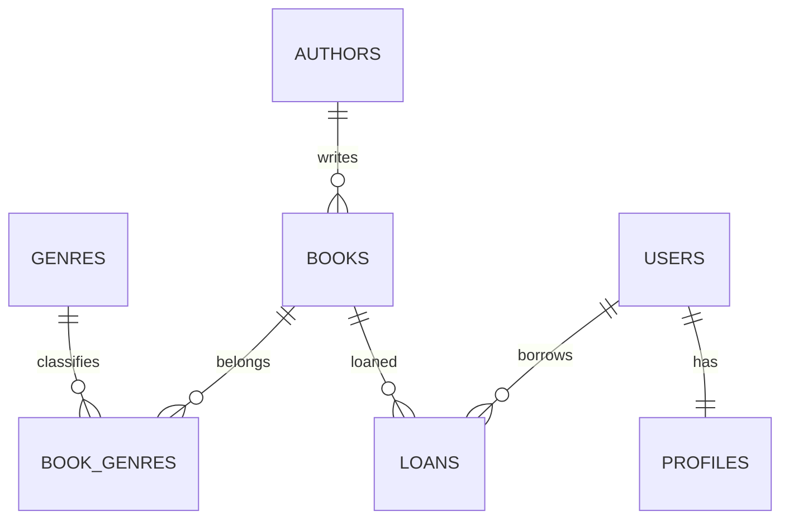

# Схема BookNest

Семь таблиц: authors, books, genres, book_genres, users, profiles, loans. Связи 1:N, M:N и 1:1. У составного ключа book_genres (book_id, genre_id). `RESTRICT` для авторов и истории выдач не допускает потерю связанных сведений; `CASCADE` удаляет профиль пользователя и строки связи при удалении книги. Жанры нормализованы в отдельную таблицу. Сохранены поля `genre` (через первую связанную запись) и `available` (вычисляемое) в JSON для совместимости с API ЛР 7.

Создайте БД, установите DATABASE_URL и выполните `alembic upgrade head`, затем `psql -d booknest -f db/seed.sql`. `db/schema.sql` — самостоятельная DDL-версия для части A (запускать на ОТДЕЛЬНОЙ пустой базе). `db/indexes.sql` соответствует второй миграции. `db/queries.sql` содержит 12 запросов. `db/benchmarks.sql` нужен для реальных замеров до/после индексов на тестовой базе. `db/invalid_cases.sql` содержит три ожидаемо неуспешные вставки.
